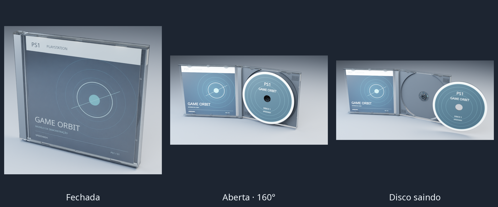

# Preparação da caixa de PS1

O arquivo `Compact disc and case.zip` contém o modelo de effe publicado no Blend Swap, com licença CC0. Foram escolhidas uma tampa transparente, base, bandeja, livreto e as folhas de arte. As cópias alternativas da cena original foram removidas. A licença fornecida acompanha os arquivos em `assets/models/ps1/`.

O modelo usa o conceito já adotado no Orbit: a mesma caixa passa de fechada a aberta, a tampa leva o livreto e o disco sai do encaixe antes de deslizar para o lado. A abertura da prévia é de 160°. O disco avança 27 mm e desliza 96 mm, com inclinação leve. Há uma animação única `PS1_AbrirEFechar` no GLB.

Dimensões de referência da caixa: 142 × 125 × 10 mm; disco de 120 mm com furo de 15 mm e bordas transparentes de 0,5 mm. A caixa deriva da geometria do anexo. O disco foi reconstruído em anéis de 96 segmentos para preservar círculos ao reduzir o detalhe. A malha inicial tem aproximadamente 11,8 mil triângulos; base, tampa, papel e disco conservam seus materiais e movimentos separados.

As imagens originais de capa e disco estavam vinculadas a arquivos externos não incluídos no ZIP. A prévia usa arte demonstrativa criada para este estudo, com fonte Noto Sans e sua licença OFL já presentes no projeto. O Blender contém imagens empacotadas; o GLB contém imagens e animação incorporadas.

Os eixos do GLB são os usuais do formato, em metros. Para o renderer nativo do Orbit, a futura adaptação precisará converter unidades, materiais, UVs e articulações. As peças e os pivôs já estão separados, mas a conversão para a malha e os shaders RSX ainda não foi integrada.

Esta é uma prévia para avaliar o modelo. A renderização usa iluminação de estúdio no computador. A apresentação no PS3 será avaliada depois da integração, assim como descoberta de jogos em PSXISO, artes por jogo e tratamento de vários discos.
